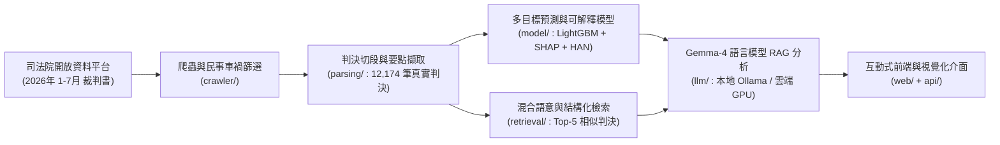

# ⚖️ 智慧司法判決預測與可解釋案例分析系統
**Taiwan Civil Traffic Accident Judgment Prediction & Explainable Case Analysis System**

- **專題組別**：資工三B 專題 F 組（陳冠瑋、許祐愷、徐德晉、呂映彤、趙元寧）
- **指導教授**：吳孟倫 教授
- **研究範疇**：台灣地方法院第一審**民事車禍侵權損害賠償**判決預測與可解釋分析
- **🌐 線上展示網站（24 小時雲端版）**：**[https://urichao-traffic-verdict-predictor.hf.space](https://urichao-traffic-verdict-predictor.hf.space)**

---

## 📌 系統架構與核心特色



1. **真實司法院判決資料管線（`crawler/`、`parsing/`）**
   - 支援司法院開放資料平台每月壓縮檔（`.rar`）批次擷取，與每日 00:00–06:00 裁判書開放 API 自動增量排程並依 `JID` 雙階段去重。
   - 自動切分「主文 / 原告主張 / 被告抗辯 / 本院之判斷」，擷取**勝敗訴結果、請求總額、判准金額、傷勢嚴重度（0–4 級）、傷勢部位、住院天數、手術與失能情形、各項賠償明細（醫療、看護、不能工作損失、車損、精神慰撫金）、原告與有過失比例**。
   - 目前已完成 **2026 年 1–7 月共 12,174 筆**台灣各地方法院第一審真實民事車禍判決訓練與索引。

2. **預測模型與可解釋性分析（`model/`）**
   - **主模型（LightGBM 分類＋多目標迴歸）**：同時預測勝敗訴類別（`原告勝訴` / `部分勝訴` / `原告敗訴`）、判賠占請求比例、原告與有過失比例（民法第 217 條）、法院核定精神慰撫金（民法第 195 條）。
   - **TreeSHAP 特徵貢獻度分析**：量化本案各項傷勢、違規與過失抗辯對判賠結果之正負向影響權重，並於原文自動標註紅藍螢光筆。
   - **參考專案對照組（[`model/han_baseline.py`](model/han_baseline.py)）**：重現 [`tommy9301122/JudgmentPrediction`](https://github.com/tommy9301122/JudgmentPrediction) 之雙層（詞級＋句級）Hierarchical Attention Network (HAN) 架構，計算案情每句話之 Attention 權重（總和 = 100%）。

3. **模型實驗數據（12,174 筆真實民事車禍判決，80/20 訓練測試切分）**

| 評估指標 | 本系統主模型 (LightGBM) | 參考專案架構 (HAN Baseline) |
| :--- | :---: | :---: |
| **勝敗訴分類準確率 (Accuracy)** | **83.53%** | 57.74% |
| **Macro-F1 Score** | **0.6735** | 0.5168 |
| **原告與有過失比例誤差 (MAE)** | **3.46%** | — |
| **判賠占請求比例誤差 (MAE)** | **19.30%** | — |

4. **Gemma 4 大型語言模型白話法律分析（`llm/`）**
   - 支援本地端 Ollama（`gemma4:e4b`）與雲端 GPU（`gemma-4-26b-a4b-it`）雙模式即時串流（SSE Streaming），結合模型預測數據與檢索出的相似歷史判決（RAG），自動生成三段式繁體中文白話法律分析報告。

---

## 📂 專案目錄結構

```text
traffic-verdict-predictor/
├── api/
│   └── main.py                 # FastAPI 後端伺服器（/api/predict, /api/explain/stream, /api/reload）
├── web/
│   ├── index.html              # 互動式前端介面（案件輸入、傷勢膠囊、SHAP 圖表、HAN 句子標註、相似案例）
│   ├── engine.js               # 瀏覽器端靜態推論與雲端 Gemma-4 串流引擎
│   ├── model_bundle.json       # 匯出之精簡 LightGBM 決策樹群與 HAN 注意力權重
│   └── cases_bundle.json       # 匯出之 12,174 筆真實民事車禍判決精簡檢索庫
├── crawler/
│   ├── opendata.py             # 司法院開放資料平台每月 RAR 爬蟲
│   ├── jdg_api.py              # 司法院每日 00:00-06:00 增量 API 擷取器
│   ├── filters.py              # 民事第一審車禍侵權判決篩選器
│   └── extract.py              # 7-Zip / JSON 批次解壓與去重匯入
├── parsing/
│   ├── sections.py             # 判決書「主文 / 原告主張 / 被告抗辯 / 本院之判斷」切段
│   ├── extract_rules.py        # 傷勢、違規、請求明細、主文金額與過失比例 Regex 擷取
│   ├── numbers.py              # 中文數字（萬、千、百、成、折）與阿拉伯數字正規化
│   └── build_dataset.py        # 建構結構化訓練資料集
├── model/
│   ├── features.py             # 特徵工程與台灣車禍法律專有名詞斷詞
│   ├── han_baseline.py         # 參考專案雙層 Attention (HAN) 模型實作
│   ├── train.py                # 訓練 LightGBM 分類/迴歸模型與評估指標輸出
│   ├── predict.py              # 線上推論與 TreeSHAP 可解釋計算
│   └── export_static.py        # 將訓練模型與 12,174 筆判決匯出為前端靜態推論包
├── retrieval/
│   └── index.py                # 混合 TF-IDF 語意與傷勢結構特徵之相似判決檢索
├── llm/
│   ├── client.py               # Gemma-4 語言模型串流與同步呼叫介面
│   └── prompts.py              # RAG 法律分析提示詞模板
├── artifacts/
│   ├── predictor.joblib        # 訓練完成之模型組合包
│   └── metrics.json            # 12,174 筆真實判決之訓練與測試集評估指標
├── ingest.py                   # 一鍵自動去重匯入新判決、重訓模型並熱更新伺服器
└── tests/
    └── test_pipeline.py        # 單元測試與端到端管線驗證
```

---

## 🚀 組員如何在本機下載並執行

```bash
# 1. 下載專案並建立 Python 虛擬環境
git clone https://github.com/Urichao/traffic-verdict-predictor.git
cd traffic-verdict-predictor
python -m venv .venv
.venv\Scripts\activate
pip install -r requirements.txt

# 2. 重建本機檢索索引並啟動 FastAPI 伺服器
python -m retrieval.index
uvicorn main:app --reload
```

啟動後開啟瀏覽器前往 **http://127.0.0.1:8000** 即可使用完整系統。
